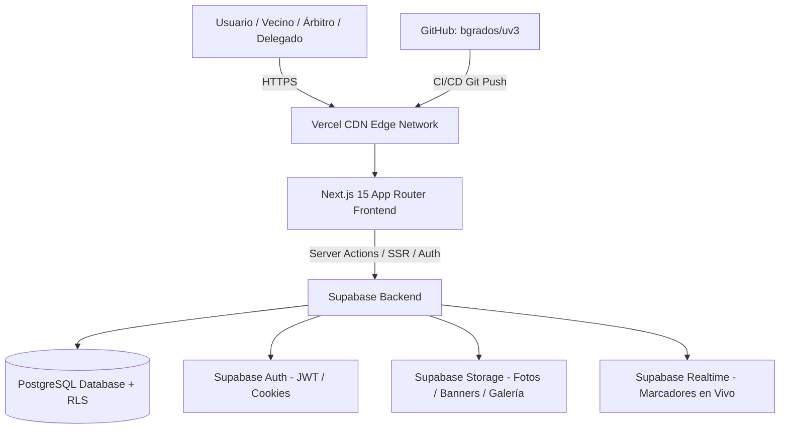

# UV3 Platform — Documentación Integral y Plan de Escalabilidad

> **Plataforma Digital Deportiva y Vecinal de la Unidad Vecinal 3**  
> *Versión del Documento: 1.0.0 — Octubre 2026*  
> *Stack: Next.js 15 (App Router) + React 19 + TypeScript + TailwindCSS v4 + Supabase (PostgreSQL / Auth / Storage / Realtime) + Vercel*

---

## 1. Resumen Ejecutivo del Proyecto

**UV3 Platform** es una solución integral diseñada para digitalizar la vida comunitaria y la gestión deportiva de la **Unidad Vecinal 3**. Resuelve dos necesidades esenciales en un solo ecosistema:
1. **Portal Comunitario Barrial:** Publicación de comunicados oficiales, avisos de la junta vecinal, campañas de salud, convocatorias y galería histórica/social.
2. **Sistema de Ligas y Campeonatos Deportivos:** Gestión integral de torneos (fútbol, fútbol sala, básquetbol), registro de equipos y jugadores (con control de DNI/edad), generación algorítmica automática de fixtures, actas arbitrales digitales con control de marcador en vivo y tablas de posiciones actualizadas en tiempo real.

---

## 2. Mapa de Integraciones y Ecosistema Cloud



* **Repositorio de Código:** [GitHub `bgrados/uv3`](https://github.com/bgrados/uv3)
* **Despliegue y Hosting:** [Vercel `uv3-platform`](https://vercel.com/ben-468d61e5/uv3-platform)
* **Base de Datos & Backend:** [Supabase `qhafedyvlwwzjzkwbvsu`](https://supabase.com/dashboard/project/qhafedyvlwwzjzkwbvsu)

---

## 3. Arquitectura del Repositorio

```text
uv3-platform/
├── .vercel/                  # Configuración de vinculación con Vercel
├── branding/                 # Manual de identidad visual y colores oficiales
│   └── design-system.md
├── database/                 # Scripts SQL para Supabase
│   ├── schema.sql            # Estructura de tablas, triggers, constraints e índices
│   ├── policies.sql          # Políticas de seguridad RLS (Row Level Security)
│   ├── seeds.sql             # Semillas con datos de prueba realistas
│   └── migration_sport.sql   # Migraciones modulares de esquemas
├── docs/                     # Documentación técnica y guías de arquitectura
│   └── PROJECT_DOCUMENTATION.md
├── frontend/                 # Aplicación Next.js 15
│   ├── public/               # Recursos estáticos, logos e iconografía
│   ├── src/
│   │   ├── app/              # App Router (páginas, layouts, server actions)
│   │   │   ├── (auth)/       # Rutas de login, registro, recuperación de clave
│   │   │   ├── actions/      # Server Actions (torneos, fixtures, equipos, jugadores)
│   │   │   ├── announcements/# Módulo de comunicados vecinales
│   │   │   ├── dashboard/    # Panel administrativo y control de arbitraje
│   │   │   │   ├── matches/  # Control de partidos y panel de marcador en vivo
│   │   │   │   └── tournaments/ # Administración y generador de fixtures
│   │   │   ├── gallery/      # Galería fotográfica vecinal
│   │   │   ├── teams/        # Directorio público de equipos y plantillas
│   │   │   ├── tournaments/  # Vistas públicas de torneos, fixtures y posiciones
│   │   │   ├── globals.css   # Variables CSS y tokens de diseño Tailwind v4
│   │   │   ├── layout.tsx    # Layout raíz con navbar y pie de página
│   │   │   └── page.tsx      # Portada principal comunitaria con datos dinámicos/fallbacks
│   │   ├── components/       # Componentes interactivos reutilizables (LiveMatchCard, etc.)
│   │   ├── types/            # Definiciones de tipos TypeScript compartidos
│   │   ├── utils/            # Motor de fixtures y clientes Supabase SSR/Browser
│   │   └── middleware.ts     # Control de sesiones y cookies SSR
│   ├── package.json
│   └── tsconfig.json
├── prompts/                  # Requerimientos originales y especificaciones funcionales
└── skills/                   # Directrices especializadas de diseño y base de datos
```

---

## 4. Módulos Funcionales Existentes

### 4.1. Motor Automático de Fixtures (`frontend/src/utils/fixtures.ts`)
* **Formato Liga (Round-Robin):** Algoritmo del círculo de rotación de Berger ($N-1$ fechas). Gestiona de forma nativa cantidades impares de equipos mediante equipos virtuales `BYE` (fecha de descanso).
* **Formato Eliminación Directa (Knockout):** Generación de llaves desde dieciseisavos/octavos/cuartos hasta la final, calculando potencias de 2 y pases directos (*byes*) cuando el número de participantes no es potencia perfecta.
* **Formato Mixto (Grupos + Playoff):** División configurable de equipos en grupos, generación de fixture interna por grupo y cruces posteriores para fases eliminatorias.
* **Asignación de Horarios y Sedes:** Vinculación con slots de disponibilidad (`schedules`) distribuyendo los partidos automáticamente por día y cancha.

### 4.2. Control de Arbitraje y Marcador en Vivo
* Interfaz táctil y responsiva (`MatchScoreControl.tsx`) diseñada para que árbitros o comisarios de mesa registren goles con un solo clic.
* Bitácora de incidencias cronológica local.
* Recálculo automático de la tabla de posiciones (`standings`) cuando el estado del partido pasa a `completed`.

### 4.3. Sistema de Autenticación y Autorización Granular (RBAC)
* Implementado con `@supabase/ssr` en Server Components y Server Actions.
* Roles del sistema:
  * `admin`: Acceso irrestricto a torneos, comunicados, usuarios, finanzas y configuración.
  * `organizer`: Creación y edición de campeonatos, generación de fixtures y asignación de árbitros.
  * `delegate`: Delegado de equipo; administra la plantilla de su equipo (jugadores, dorsales, fotos).
  * `referee`: Asignado a partidos específicos para cargar alineaciones, goles, tarjetas y resultado final.
  * `user`: Vecino o simpatizante general con acceso a consultar información, tablas, fotos y noticias.

### 4.4. Portal de Noticias y Galería Multimedia
* Categorización de comunicados (`general`, `deportes`, `eventos`, `comunicado`).
* Álbumes de fotos con almacenamiento de URLs e integración de imágenes optimizadas mediante Next.js `Image`.

---

## 5. Diseño y Sistema Visual

Basado en la identidad histórica y comunitaria de la **Unidad Vecinal 3**:
* **Verde Principal:** `#14833B` — Vitalidad, naturaleza, campos deportivos.
* **Verde Oscuro:** `#0E5A28` — Contraste, barras de navegación y pie de página.
* **Dorado / Amarillo:** `#D8B400` — Campeonatos, medallas, acentos de alerta y destaques.
* **Fondo Claro:** `#F5F7F2` — Superficie limpia y descansada para lectura vecinal prolongada.
* **Tipografías:** `Inter` (cuerpo de texto de alta legibilidad en pantallas móviles) y `Poppins` (títulos modernos y enérgicos).

---

## 6. Diagnóstico y Recomendaciones para Escalar la Plataforma

Para llevar **UV3 Platform** de su estado actual a una plataforma de nivel profesional capaz de gestionar múltiples ligas simultáneas, miles de vecinos y tráfico concurrente durante finales o asambleas, se recomiendan las siguientes mejoras estructuradas en 6 ejes:

### Eje 1: Base de Datos y Rendimiento (PostgreSQL / Supabase)

1. **Vistas Materializadas o Tablas Agregadas para `standings`:**
   * *Situación actual:* La tabla de posiciones se recalcula o consulta con joins en tiempo real.
   * *Recomendación:* Implementar un trigger en PostgreSQL que actualice `standings` atómicamente tras el cierre de cada partido mediante una función `SECURITY DEFINER`, o usar una `MATERIALIZED VIEW` refrescada concurrentemente (`REFRESH MATERIALIZED VIEW CONCURRENTLY`).
2. **Estrategia de Índices Críticos:**
   * Crear índices compuestos en `matches (tournament_id, round)`, `matches (status)`, `players (team_id, dni)` y `standings (tournament_id, points DESC, goal_difference DESC)`.
3. **Control de Auditoría y Trazabilidad:**
   * Agregar una tabla `match_events` (minuto, jugador, equipo, tipo de gol o tarjeta, árbitro que lo registró) en lugar de depender únicamente de campos acumuladores. Esto permite estadísticas individuales detalladas (tabla de goleadores y arqueros menos batidos).

### Eje 2: Experiencia en Tiempo Real (Realtime WebSockets)

1. **Suscripción a Supabase Realtime en Partidos en Vivo:**
   * *Situación actual:* Se utiliza un polling periódico (`LiveAutoRefresh.tsx`) de 30 segundos.
   * *Recomendación:* Implementar canales WebSocket con `supabase.channel('public:matches')` para actualizar el marcador instantáneamente en los teléfonos de todos los vecinos cuando el árbitro presione el botón de gol, eliminando llamadas innecesarias al servidor.

### Eje 3: Gestión de Archivos y Multimedia (Supabase Storage)

1. **Buckets Privados y Públicos con CDN:**
   * Configurar 3 buckets en Supabase Storage:
     * `team-logos` (público, con compresión WebP automática).
     * `player-photos` (público/restringido, verificación de identidad por delegados).
     * `community-gallery` (optimizado para álbumes fotográficos de alta resolución).
2. **Subida Directa desde el Cliente con Signed URLs:**
   * Implementar subidas seguras pre-firmadas para no saturar las Serverless Functions de Vercel con buffers de imágenes de alta resolución.

### Eje 4: Experiencia Móvil y Modo Offline para Árbitros (PWA)

1. **Soporte PWA (Progressive Web App):**
   * Configurar `manifest.json` y Service Workers para que los delegados y vecinos puedan "instalar" UV3 como una app en Android e iOS sin pasar por las tiendas de aplicaciones.
2. **Módulo Offline-First para Árbitros en Cancha:**
   * En los campos de juego donde la señal 4G/5G suele degradarse, permitir que el árbitro cargue las incidencias en memoria local (IndexedDB) y se sincronicen automáticamente con Supabase en cuanto se recupere la conexión.

### Eje 5: Seguridad, Reglas de Negocio y Validación

1. **Validación de Elegibilidad de Jugadores:**
   * Regla de negocio en base de datos para impedir que un mismo jugador esté inscrito en dos equipos distintos en el mismo torneo.
   * Validación automática de suspensión por acumulación de tarjetas (ej. 2 amarillas en partidos consecutivos o 1 roja directa = 1 o más fechas de suspensión automática en la siguiente fecha del fixture).
2. **Protección de Rutas en Middleware:**
   * Enriquecer [`middleware.ts`](file:///f:/uv3-platform/frontend/src/middleware.ts) para validar el rol del usuario en la sesión antes de permitir el acceso a rutas protegidas (`/dashboard/tournaments`, `/dashboard/matches`), evitando carga innecesaria en el renderizado del servidor.

### Eje 6: Integración Continua y DevOps

1. **Flujo de Migraciones con Supabase CLI:**
   * Versionar los cambios de base de datos en carpetas `supabase/migrations/` ejecutables automáticamente mediante GitHub Actions en cada Pull Request a `main`.
2. **Entornos de Staging en Vercel:**
   * Conectar ramas secundarias (ej. `develop` o PRs) a proyectos de staging en Supabase para probar nuevos torneos y funcionalidades sin afectar los datos en vivo de la junta vecinal.

---

## 7. Hoja de Ruta Sugerida (Roadmap de Implementación)

| Fase | Duración Estimada | Entregables Principales |
| :--- | :--- | :--- |
| **Fase 1: Configuración & Enlace** | Inmediata | Carga de claves reales en `.env.local` y Vercel, ejecución de esquemas y políticas RLS en Supabase, verificación de primer inicio de sesión. |
| **Fase 2: Motor Deportivo Completo** | 1 - 2 semanas | Tabla de goleadores, sanciones automáticas por tarjetas, actas de partido en PDF descargables para delegados. |
| **Fase 3: Optimización Realtime & PWA** | 2 semanas | Suscripción WebSocket a partidos en vivo, configuración de Service Worker (PWA) e interfaz móvil optimizada para árbitros en cancha. |
| **Fase 4: Portal Comunitario Avanzado** | 2 semanas | Módulo de reservas de canchas comunales con horarios, votaciones vecinales y buzón de sugerencias a la junta directiva. |

---

*Documentación elaborada para el equipo de desarrollo de la Unidad Vecinal 3.*
